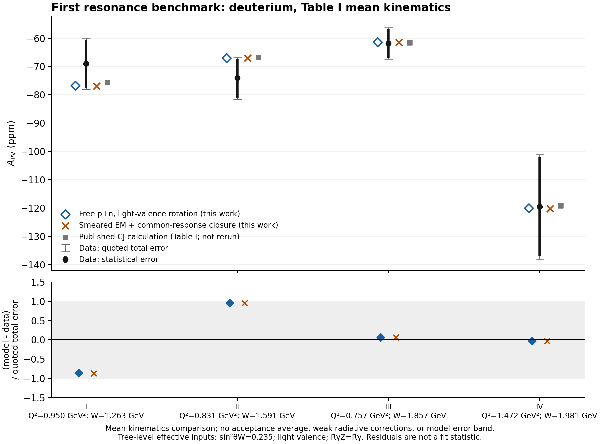
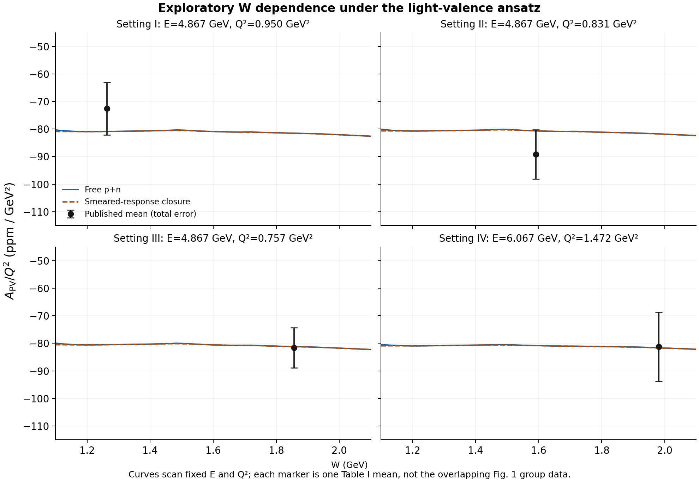

# PVDIS study: inelastic/resonance A_PV first

**Sharing policy:** growing data, diagnostics, snapshots, reports and ZIPs remain local. Share a verified ZIP with chat on request; do not push these artifacts to GitHub. Existing code and project memory may remain. See SHARING_POLICY.md. Build a sharing archive without rerunning science or editing the PDF using `python tools/build_study.py --mode bundle`. A code-only checkout requires the separately supplied bundle for its local study inputs and retained evidence.

Latest additive investigation: [WEAK_RESPONSE_ASSESSMENT.md](WEAK_RESPONSE_ASSESSMENT.md) documents the vector-first input gate, 900 matched component calculations, a conditional Delta-only diagnostic with the axial prescription fixed, the repeated four Hall A mean comparisons and 11 GeV cross-section/validity warnings. The original reference remains preserved. No complete improved weak-response model is claimed. Reconstruct the new CSVs with `python tools/verify_component_study.py --recompute`; execute a fresh study with `python tools/run_component_study.py`.

**Priority correction, October 25, 2026:** the urgent artifact is inelastic/resonance A_PV for the MOLLER workshop, with preliminary results Monday afternoon October 26 and more complete work Tuesday October 27. The broader PAC coupling-ellipse optimization is secondary. Reporting infrastructure, notebook auditing, and the first four-point comparison do not complete the urgent physics goal. See `CURRENT.md` and the active order in `ROADMAP.md`.

The cumulative report now leads with a fresh 11 GeV calculation over eight reference angles and W=1.10-2.20 GeV. Its sealed `resonance_studies/` evidence contains 896 new scan points, four benchmark means, 10,800 controlled weak-response scenarios and 40 representative kinematics. These are conditional light-valence reference curves, not a validated weak resonance model. Rates and statistical reach remain explicitly unavailable.

Run `python tools/run_resonance_study.py` to create a fresh model study, `python tools/verify_resonance_study.py --recompute` to verify/reconstruct it, and `python tools/build_study.py --mode report` to update the PDF/bundle. A pure-isospin component-limit diagnostic is recorded separately; it is not silently substituted for the inclusive deuteron response.

## Historical first benchmark

Date: 2026-10-25. This is a local, executed model benchmark, not a simulation of an accepted experimental yield or a fit to couplings. The broader study has **30 PAC days total**. MOLLER is the first presentation milestone within the PAC study.

## Numerical result

The unchanged, pinned F1F2IN21 electromagnetic model was executed at the four published mean kinematics and on four W grids. Two explicitly defined light-valence constructions are compared with the measured physics asymmetries:

| Setting | E (GeV) | Q² (GeV²) | W (GeV) | Measured A (ppm), total error | Free p+n rotation (ppm) | Smeared-response closure (ppm) |
|---|---:|---:|---:|---:|---:|---:|
| I | 4.867 | 0.950 | 1.263 | -68.97 ± 9.09 | -76.836 | -76.857 |
| II | 4.867 | 0.831 | 1.591 | -74.12 ± 7.43 | -67.039 | -67.018 |
| III | 4.867 | 0.757 | 1.857 | -61.80 ± 5.50 | -61.444 | -61.463 |
| IV | 6.067 | 1.472 | 1.981 | -119.56 ± 18.42 | -120.131 | -120.195 |

Data: [arXiv:1304.7741v2, Table I](https://arxiv.org/pdf/1304.7741v2). CSV retains statistical and systematic errors separately. The paper's CJ numbers are retained only as published reference values; that calculation was not rerun. No p-value or combined chi-square is reported because there is no full experimental/systematic covariance or model covariance here.

The free p+n residuals are all within 0.96 of one quoted total experimental error. This is a useful first compatibility check. It is not acceptance-level validation of the model or a precision determination of weak couplings. The model is evaluated at published mean Q² and W; those are not necessarily the same as averaging the model over the accepted events.





## Model and conventions

Signed asymmetry: A=(sigma_R-sigma_L)/(sigma_R+sigma_L). Constants deliberately retain the uploaded calculation's effective baseline: GF=1.166e-5 GeV^-2, alpha=0.0073, sin²θW=0.235, M=0.938272 GeV. This is a declared tree-level effective prescription; it is not a complete electroweak radiative-correction scheme.

We use half-isospin couplings gAe=-1/2, gVe=-1/2+2s², gVu=1/2-4s²/3, gVd=-1/2+2s²/3, gAu=1/2, gAd=-1/2. Thus Ciq=2*g_e*g_q, C1=2C1u-C1d=-0.7166667, C2=2C2u-C2d=-0.09.

Electromagnetic inversion uses effective light flavors U=6(4F1p-F1n)/5 and D=6(4F1n-F1p)/5. The ansatz neglects strange, charm, and antiquarks; qminus=qplus is an assumption. It does not extract literal resonance-region PDFs.

With charge symmetry, summing p+n cancels the effective flavor shape from the transverse ratios:

- F1gammaZ/F1gamma = (6/5)(2gVu-gVd).
- F3gammaZ/F1gamma = 18/5 in the light-valence approximation.
- A_ppm = [3*GF*Q²/(10*sqrt(2)*pi*alpha)]*1e6*[C1*Y1+C2*Y3].

The gamma-Z definitions are F1gammaZ=sum(e_q*gVq*qplus), F3gammaZ=2*sum(e_q*gAq*qminus). These normalization factors are important when translating the supplied slide.

For the free p+n model, Rgamma is obtained from the sum of the computed electromagnetic F1 and F2. Nominal RgammaZ=Rgamma, so Y1=1. Y3 includes finite-Q² and nucleon-mass kinematics. Its denominator is

`D = 1+(1-y)^2-y^2*(1-r^2/(1+Rgamma))-x*y*M/E`,

with Y3=`r^2/(1+Rgamma)*y*(2-y)/D`, r²=1+4M²x²/Q². This follows the **v4** Eq. (13) of [Hobbs and Melnitchouk](https://arxiv.org/pdf/0801.4791v4). The expression is independently checked against the direct electromagnetic/interference response contraction, avoiding an erroneous factor of two in the mass term.

The smeared alternative uses the unchanged deuteron electromagnetic fit with CD-Bonn on-shell smearing and QE excluded. It then **imposes** the same transverse response on F1gamma, F1gammaZ, and F3gammaZ, and the same longitudinal ratio on gamma and gamma-Z. It does not calculate axial nuclear smearing or transition amplitudes. The unsmeared weak numerator is never divided by a smeared electromagnetic denominator.

## What the small differences mean

At the four means, deuteron EM smearing changes F1 relative to the free sum by about -5.43%, +4.92%, +0.94%, and -0.40%. Nevertheless, under the imposed common-response ansatz the asymmetry changes by only -0.021, +0.021, -0.019, and -0.064 ppm. The cancellation is built into the ansatz; it is **not evidence that weak nuclear effects are known to 0.07 ppm**.

Setting RgammaZ=0.8Rgamma or 1.2Rgamma, while holding the transverse prescription fixed, changes the smeared-closure asymmetries by ±2.08, ±2.93, ±2.67, and ±5.02 ppm. This is an illustrative dependence on an unknown input, not a calibrated uncertainty band. A separate column uses sin²θW=0.232 only as a declared convention sensitivity; no value was tuned to the data.

Smooth curves follow naturally from isoscalar flavor cancellation plus the chosen R and kinematics. This construction cannot independently demonstrate the absence of weak resonance structure, establish pointwise duality, or replace a resonance axial model. The W curves cover 1.1–2.1 GeV at fixed E and Q²; the measured points are the Table I means, not the correlated group-trigger bins of Fig. 1.

## Execution and validation

- Model source is byte-identical to [mc-single-arm at 2a27ddb7442a](https://github.com/trottar/mc-single-arm/blob/2a27ddb7442ab2148e47fe4f3e998cf1be0a9fa8/src/F1F2IN21_v1.0.f).
- Three smearing tables independently match GitHub blob identities at [simc_gfortran 641b8c07182f](https://github.com/trottar/simc_gfortran/tree/641b8c07182fd045fd8a5c007cdc1b71a418f3ce/f1f2tables). They were copied from verified workspace bytes, not generated or altered.
- GNU Fortran 13.3.0, bounds checks and invalid/zero/overflow traps; explicit GETFY initialization.
- Four mean points plus 804 W-scan points; all finite, positive EM responses and effective light flavors.
- Fresh-process repeat is byte-identical. Independent flavor reconstruction, direct-response/Y-factor agreement, Bjorken limit, and invalid-input rejection passed.
- Plot images were visually inspected. Data-point error bars show the quoted experimental errors, not a theory band.
- No rates, beam-time statistical forecast, acceptance folding, radiative migration, HT/CSV fit, or external-prior combination was executed.

## Reproduce

From the workspace root, using Windows Python with matplotlib for plotting and WSL for Fortran:

```text
python pvdis-study/tools/prepare_inputs.py
wsl --exec sh <absolute-WSL-study-path>/tools/get_compiler.sh
wsl --exec sh <absolute-WSL-study-path>/tools/build_probe.sh
wsl --exec sh <absolute-WSL-study-path>/tools/run_probe.sh
python pvdis-study/src/analyze.py
python pvdis-study/src/plot_results.py
```

`prepare_inputs.py` identifies the adjacent read-only workspace table files and verifies them against pinned repository objects. If those files are absent, retrieve the exact three tables from the recorded simc commit before rerunning; the script fails rather than substituting a model. `get_compiler.sh` is needed only if its workspace compiler is absent. Package files and compiler version are retained in `build/`; input and result receipts are in `results/`.

Review [DEPENDENCIES.md](DEPENDENCIES.md) before extending this into rate projections. Publication of this study and its reproducibility bundle to the `pvdis` branch was explicitly authorized by the user on October 25, 2026. Publication is separate from the numerical build workflow; no hosted CI or production execution is implied.

## Cumulative PDF and reproducibility record

The building report is `output/pdf/pvdis_pac_study.pdf`. Its review bundle is `output/pdf/pvdis_pac_study_bundle.zip`. Both are regenerated from validated, indexed snapshots under `runs/`; previous snapshots are preserved. The first collection records the retained benchmark, and a second collection records a fresh end-to-end compiled rerun with identical physics inputs. These are two execution records, not two independent experimental datasets.

From this study directory:

```text
python tools/build_study.py --mode collect
python tools/build_study.py --mode refresh
python tools/build_study.py --mode full
python tools/build_study.py --mode report
```

`collect` checks retained evidence and adds a snapshot. `refresh` reruns analysis/figures from existing raw model values, then collects. `full` prepares verified inputs, compiles and reruns Fortran, reruns analysis/figures, and collects. `report` verifies the existing snapshots and rebuilds only the PDF/bundle. Defaults never silently rerun a model. All external stage commands record arguments, return codes, stdout and stderr under `build/commands/`.

Use the pinned `requirements-analysis.txt` and `requirements-report.txt` for the separate analysis and report environments, or provide a compatible combined environment. The build driver detects the available bundled report interpreter on this host; elsewhere use `--report-python <python>` or `PVDIS_REPORT_PYTHON`. The report requirements include pdfplumber for PDF word-bound checks. `PVDIS_FC` and `PVDIS_RUNTIME_LIB` can select an available Fortran compiler/runtime on Linux. On Windows, full model execution uses WSL. The downloaded compiler packages are workspace-only and intentionally excluded from the portable review ZIP; `tools/get_compiler.sh` documents how to obtain them.

Each snapshot includes `diagnostics.json` for all 808 points, `data_dictionary.json` with units, current analysis source, original measurement CSV, exact tables, raw outputs, figures, guard logs, and provenance. `python tools/verify_snapshot.py <snapshot-directory>` independently checks its file inventory and hashes. `python tools/test_collection.py` exercises stale-file and wrong-value rejection without modifying original evidence.

The current PDF is rendered to page images and checked for nonblank text, required run content, and out-of-page text. Visual inspection remains a separate human/model review step. The bundle has its own complete SHA-256 manifest and ZIP integrity check. Historical `results/artifact_hashes.json` is explicitly superseded for current-build validation by the generation receipt and snapshot manifests.

## Received fit notebook

The user's notebook is retained byte-for-byte in the indexed `notebook_reviews/` evidence collection. Its 39 cells were inspected, and only selected reviewed function definitions plus the inline Hall A DIS dataset were executed; Drive was not mounted and no file-dependent projection cell was run. A separate JSON/CSV audit records the HT/CSV templates, missing input files, confidence convention, time scaling, covariance construction, parser behavior, and recentering issues. Run `python tools/verify_notebook_review.py --recompute` to verify the sealed files and reproduce the selected inline fit. The cumulative PDF appends these findings without altering the earlier resonance snapshots.

## Download for chat analysis

- Report: [output/pdf/pvdis_pac_study.pdf](output/pdf/pvdis_pac_study.pdf)
- Complete reproducibility bundle: [output/pdf/pvdis_pac_study_bundle.zip](output/pdf/pvdis_pac_study_bundle.zip)
- Active priority and remaining gates: [CURRENT.md](CURRENT.md)
- New 11 GeV results and controlled response probes: [resonance_studies/20261025T193128315988Z](resonance_studies/20261025T193128315988Z)

For analysis in a chat, attach the PDF and, where supported, the ZIP. If individual data files are preferable, start with `nominal_predictions.csv`, `representative_kinematics.csv`, `response_scenarios.csv`, `benchmark_response_comparison.csv`, `study.json`, and `diagnostics.json` from that resonance-study directory. These are conditional model results, not accepted detector predictions or a complete weak resonance model. The exact original reference notebook is retained inside the bundle and the notebook-review directory. Compiler packages and transient caches are excluded; reproduction instructions and package identities are included.
